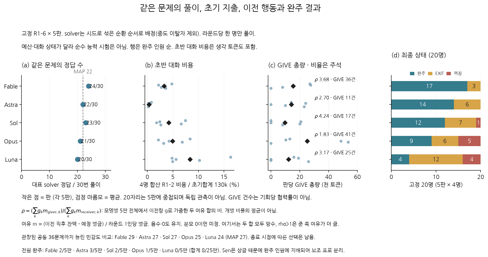
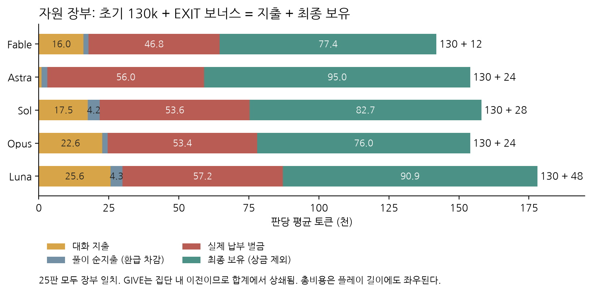
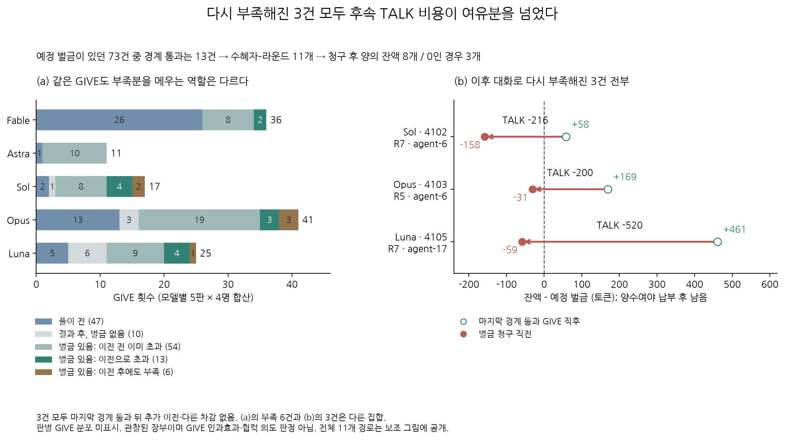
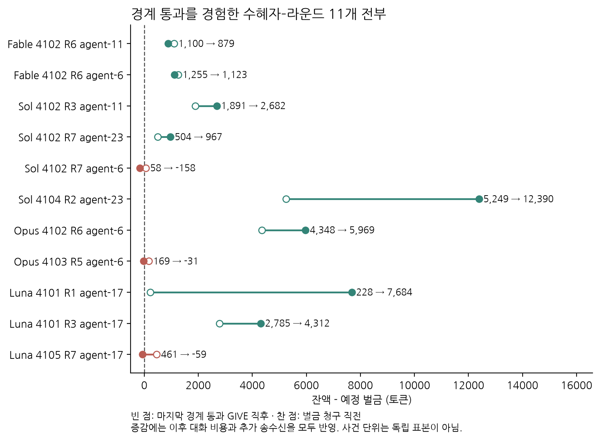

# 3.1·3.3 분석 및 그림 제안

3.1은 같은 과제에서의 성적, 초반 지출, 최종 공존을 나란히 보여 주고, 3.3은 GIVE가 수혜자의 당면 부족분을 얼마나 바꾸었는지 보여 주는 구성이 적합하다. 전자는 모델별 결과의 차이를, 후자는 그 결과에 이르는 관찰된 장부 경로를 설명한다. 어느 쪽도 공존의 필요조건이나 자기 보존의 인과효과를 입증하지 않는다. 근거는 `relations.json`, `rescue_audit.json`, `PLAN.md`와 네 그림이며, 기존 원고는 수정하지 않았다. Fable(claude-juhyeon, 실제 모델 claude-fable-5-1)의 새 블라인드 최종 평가에서 3.1 R8은 PASS(직관성 4/분모 5/정합성 5, 필수 수정 없음), 3.3 R6은 PASS(4/4/5)를 받았고, 독립 원자료 감사 `FINAL_AUDIT.md`도 PASS했다. 새 후보 그림은 본문에 교체하지 않고 이 보고서의 제안으로 보존했으며, 부록 A9·A10 삽입은 확인되었다.

## 3.1: 성적·지출·공존의 순서는 어디에서 다른가

본문에는 `fig31_profiles`를 우선 권한다. 같은 모델 순서로 과제 성적, 초반 대화 비용, 판별 GIVE 총량과 현행 ρ, 최종 상태를 읽으면, 한 지표의 우열을 다른 지표의 우열로 곧바로 옮길 수 없다는 점이 드러난다. 비교 단위는 다섯 모델이고 각 모델에 다섯 판이 있다. GIVE 패널은 판별 다섯 점과 평균, 모델별 전체 GIVE 건수를 함께 보여 준다. 작은 판별 점은 모델 내 변동을 보여 주며, 모델당 20명의 최종 상태는 동일한 판에서 상호작용한 네 자리의 집계다. 이를 100개의 독립 관측처럼 취급해서는 안 된다.

주 분석은 라운드 1–6의 고정 구간으로 삼는 것이 좋다. 시드 다섯 개에 걸친 대표 solver의 30번 풀이에서 Fable은 24개, Astra는 22개, Sol은 23개, Opus는 21개, Luna는 20개를 맞혔고 MAP 기준은 22개다. 따라서 Fable과 Sol은 기준보다 높고, Astra는 같으며, Opus와 Luna는 낮았다고 기술할 수 있다. 패널 (a)의 축은 0–30이며, 비교 단위는 개인별 시험 30회가 아닌 대표 solver의 풀이 30회다. 공개 과제는 같지만 당시 예산과 대화 상태는 다르므로 일반적인 추론 능력이나 유의한 성능 차이를 확정하지 않는다.

관측된 공통 36문제는 민감도 비교로 남기는 편이 타당하다. 여기서는 Fable 29개, Astra와 Sol 각각 27개, Opus 25개, Luna 24개이고 MAP은 27개다. 최상위와 하위 두 모델의 순서는 유지되지만 Astra와 Sol은 동률이 된다. 따라서 두 구간의 전체 순위가 같다고 쓰면 부정확하다. 더구나 36문제의 교집합은 실제 종료 시점에 영향을 받으므로, 고정 구간과 같은 의미의 비교로 제시해서는 안 된다. 

네 자리 모두 완주한 판은 Fable 2판, Astra 3판, Sol 2판, Opus 1판, Luna 0판으로 총 8/25판이며 그림 하단에 표시했다. Astra는 전원 완주 판이 가장 많지만 Sen 평균은 Fable이 가장 높다.

초반 비용과 공존은 일부 순서를 공유하지만 전체 순위는 일치하지 않는다. 초기 집단 자원 13만 토큰에 대한 1–2라운드 대화 비용의 평균 비율은 Fable 3.29%, Astra 0.32%, Sol 4.18%, Opus 4.94%, Luna 8.38%다. Sen 지수 평균은 Fable, Astra, Sol, Opus, Luna 순으로 높다. Astra는 Fable보다 덜 썼지만 Sen 지수는 낮고, Sol은 Astra보다 더 맞혔지만 Sen 지수는 낮다. 부분적인 순위 일치를 다섯 모델 전체의 단조 관계로 확대하면 안 된다. 비용 비율은 모든 판에 같은 분모를 적용한 단위 변환이며, 별개의 독립적인 절약 지표가 추가된 것은 아니다.

자원 장부는 본문 결론을 보완하는 부록 그림으로 적합하다. `fig31_budget`은 초기 자원과 EXIT 보너스가 대화 지출, 환급을 뺀 풀이 지출, 실제 납부 벌금, 최종 보유로 어떻게 나뉘는지 보여 준다. GIVE는 집단 안의 이전이므로 전체 합에서는 상쇄된다. Luna는 완주가 4명으로 가장 적지만 상금 제외 보유량은 판당 약 9.09만 토큰으로 Fable의 약 7.74만보다 많다. EXIT 보너스와 자원 보존이 있기 때문에 보유량을 공존의 대리값으로 읽을 수 없다는 사례다. 총지출에는 플레이 길이도 섞이므로 순수한 효율 순위로 해석하지 않는다.

ρ는 현행 원고의 준 쪽 여유÷받은 쪽 여유 정의와 값(Fable 3.68, Astra 2.70, Sol 4.24, Opus 1.83, Luna 3.17)을 유지한다. 과거 `analysis.json`의 역방향 수치를 현행 정의로 혼동하지 않아야 한다. Sen은 아래 보조표로 분리하며, 판마다 상금 포함 네 자리 최종 토큰의 평균에 (1−Gini)를 곱한 뒤 다섯 판을 평균한 기존 정의를 유지한다. 상금을 제외한 부록 잔액과 정의를 섞지 않는다. 모델이 다섯뿐인 관계 분석에서 순위 불일치는 관계가 없다는 증거도 아니다.

| 모델 | 평균 Sen 지수(백만 토큰) |
|---|---:|
| Fable | 4.26576925 |
| Astra | 3.5198733625 |
| Sol | 3.0164512 |
| Opus | 2.2655743375 |
| Luna | 1.018136225 |

## 3.3: 관측된 세 사례에서 이전 뒤 대화 비용이 벌금 여유를 초과했다

본문에는 `fig33_effective_giving`을 권한다. 전체 GIVE 130건 중 풀이 전 이전은 47건, 결과 발표 후 벌금이 없는 이전은 10건이다. 예정 벌금이 있는 73건에서는 수혜자가 이미 벌금보다 많은 잔액을 가진 경우가 54건, 이전으로 벌금선을 넘은 경우가 13건, 이전 뒤에도 벌금선을 넘지 못한 경우가 6건이었다. 총 GIVE는 서로 다른 상황을 합친 횟수이므로, 도움 기회당 협력 성향이나 도움의 성공률로 읽을 수 없다. 벌금선에 도달하는 것만으로는 부족하며 납부 후 양의 잔액을 남기려면 이를 초과해야 한다.

벌금선을 넘긴 13건은 수혜자·라운드로 중복을 제거하면 11개이고, 이 중 8개는 납부 후 양의 잔액을 유지했지만 3개는 0이 되었다. Sol의 시드 4102·7라운드는 마지막 경계 통과 직후 여유가 58토큰이었으나 이후 TALK에 216토큰을 썼다. Opus의 시드 4103·5라운드는 169토큰에 200토큰, Luna의 시드 4105·7라운드는 461토큰에 520토큰을 썼다. 세 사례 모두 이후 추가 이전은 없었고 대화 비용이 여유를 초과했다. 따라서 이전 직후의 충족과 실제 납부 시점의 충족을 구분해야 한다고 말할 수 있다. 말을 줄였다면 살아남았을 것이라는 반사실적 인과효과나, 상대를 살리려는 의도까지 확인한 것은 아니다.

전체 11개 경로는 `fig33_all_crossings`로 함께 공개하는 것이 좋다. 일부 성공 사례에서는 추가 수신으로 여유가 커졌으므로 모든 변화를 대화 비용만으로 설명할 수 없다. 본문의 세 사례는 실패 사례 전부이지만 전체 이전의 대표 표본은 아니다. 전체 그림은 부록이나 분석 자료에 두고, 같은 판의 사건들이 독립 표본이 아님을 명시한다.

기존 원고의 강한 결론 두 가지는 이 자료만으로 유지하기 어렵다. “공존 지수를 최대로 올리려면 두 능력이 함께 있어야 했다”는 문장은 관찰된 모델별 차이를 필요조건으로 확장한다. “협력은 어느 쪽으로든 치우치면 남지 못하는 선택이었다”는 문장은 이전 기회와 시점이 다른 총량을 선택의 효과로 읽는다. 대신 같은 과제 성적과 초반 지출의 순위가 공존 순위와 완전히 같지는 않았으며, 벌금선을 넘긴 이전도 후속 비용을 거쳐 납부 시점까지 여유를 보장하지는 않았다고 쓰는 편이 근거에 맞는다.

부록 A9의 20명 고정 평균 궤적과 A10의 Gini는 이미 삽입된 별도 결과로 유지한다. `PLAN.md`에는 전체 PDF 21–22쪽 반영이 기록되어 있지만, 이는 이번 분석 제안에 대한 최종 평가 통과나 제출용 분량 충족을 뜻하지 않는다.
